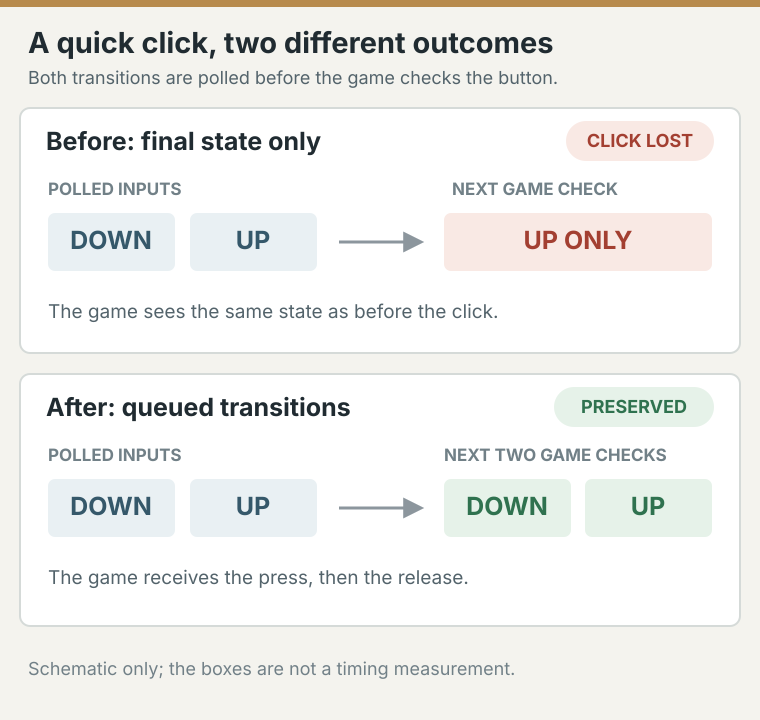

# Remastering a 1996 Sherlock Holmes game with AI

*Draft — not yet published*

> **Draft image note:** The game-derived figures below are local files in the
> ignored `validation/` directory, not assets included in the repository.
> Confirm rights and image hosting before publication.

*The Lost Files of Sherlock Holmes: The Case of the Rose Tattoo* turns 30 this year. To celebrate, I decided to give this brilliant DOS game a visual upgrade: sharper backgrounds, smoother characters, and text that doesn't look quite so blocky on a modern display.

One may ask: can't we just feed the screenshots to an AI image generator and call it a day? That was more or less my first idea. The trouble is that this is a detective game. A door needs to stay where the door is; a clue needs to say what the clue says. If the AI helpfully adds another door or rewrites a sign, Sherlock Holmes might look better while solving a different case.

So the goal became more specific: **enhance the art while letting the game remain in charge of the investigation**. The project uses a modified [ScummVM](https://www.scummvm.org/) and a legally obtained copy of the PC game. The current candidate renders at twice the original 640×480 resolution.

Love it or hate it, AI makes an overhaul of this size a one-person job. But as I found out, the interesting part wasn't just enlarging pictures. It was persuading a 256-color game to accept those pictures without losing its sprites, palettes, fog, or mouse clicks along the way.


*The candidate pack in a controlled ScummVM walking fixture. This is a captured frame, not evidence of a complete playthrough.*

## First iteration: asking AI to redraw Victorian London

My earlier experiments used diffusion-based image-to-image pipelines, including FLUX and SDXL/ControlNet. Some results were interesting! But an image generator is trying to make a *plausible* scene, not preserve a puzzle's answer. It can move objects, invent details, or confidently produce a new version of a sign.

Turning down the denoising strength makes the result look more like the input. It does not guarantee that the important parts survive. A particularly convincing hallucination is still a hallucination.

For the current candidate, I switched to [Real-ESRGAN](https://github.com/xinntao/Real-ESRGAN), a super-resolution model. Instead of asking it to redraw a room from a prompt, I give it the original pixels and ask it to enlarge them. The model still infers detail and can smooth or alter small features; clues and writing need to be checked against the originals. But it gives me a more constrained starting point.


*A comparison of background assets, not complete in-game frames. The original detail is enlarged with nearest-neighbor sampling; the candidate detail is shown at its generated 2× size.*

The model runs locally with PyTorch and [`spandrel`](https://github.com/chaiNNer-org/spandrel), so there's no image-generation server to keep running. `RealESRGAN_x4plus` produces a 4× image, which I resize to the 2× target. For a large image like the map, the script can process overlapping tiles to fit available GPU memory. Tile joins are another thing to inspect, not something I assume is invisible.

## Extracting the art: a room is not one picture

The PC version draws with a 640×480, 256-color palette. It would be tempting to extract each room's background, upscale those 80 images, and put them back. Unfortunately, that would leave a large part of the picture untouched.

Holmes, Watson, other characters, room foregrounds, and scripted animations are separate resources. A person can walk *behind* an object; an animation can replace a part of the scene; a room can scroll. A single upscaled screenshot knows none of this.

I extended the extraction tools to export room image chunks, streamed animations, walk sprites, and shared resources such as cursors and inventory items. The images come with metadata: frame indices, dimensions, offsets, resource identities, and palette information. For example, an embedded room frame can be identified by its scene, its one-based image slot, and its zero-based frame number:

```text
scene_026/room_004/frame_000@2x.png
```

That name is not just for keeping my folders tidy. It tells the renderer which replacement belongs to the image the game is drawing. An offset error, or a mix-up between two frames, can be as distracting as a blurry sprite.

The following is a small part of the local pipeline, for room sprites only. It assumes the [ESRGAN dependencies and model](esrgan-setup.md) are installed, the PC game data is in `scummvm/`, and the destination names are new. `mps` uses Apple Silicon; the tool also supports other devices.

```sh
python tools/extract_rosetattoo_room_sprites.py \
  --data-dir scummvm --output-dir extracted/room-sprites-new

python tools/upscale_rosetattoo_sprites.py \
  --input-dir extracted/room-sprites-new \
  --output-dir enhanced/room-sprites-new \
  --scale 2 --alpha-mode soft --device mps
```

The [full workflow](sprite-remaster.md) also handles animations, shared images, and palette-qualified walk sprites, then assembles and audits a pack. On my local game copy, the current candidate has **80 backgrounds, 3,640 sprite resources, and 87,656 frame paths**. That last number includes palette variants: it is not the number of unique animations, and it doesn't mean I've seen every frame in play.

To keep track of what went into the pack, source-backed checks verify frame provenance and palette sidecars. After assembly, I also compared the copied files' hashes with the selected inputs. These checks tell me what I built; they don't tell me whether the engine uses every replacement correctly.

## Teaching ScummVM about higher-resolution layers

ScummVM is a collection of reimplementations of classic game engines. That gives me a place to change rendering without patching the original DOS executable. It also means that dropping PNGs into a folder is not enough: the Sherlock engine needs to know when and how to use them.

The fork's true-color compositor draws replacement artwork alongside the native scene, accounting for scrolling, sprite scale, and drawing order. The goal is for Holmes to remain behind the same foreground object, even if both now have more pixels. The fork also handles the map, cursor, and UI, and can render supported text with a vector font.

The important distinction is that the **pictures don't define the walk zones or hotspots**. Those still come from the game. I'm trying to preserve puzzle placement, timing, layering, and save behavior as well, but that is a design constraint; it is not yet a full-playthrough guarantee.


*An earlier palette pilot, not the final candidate: the left panel uses a qualified replacement frame; the other two fall back to native artwork when the sidecar is missing or the palette differs. In this fixture, the pool table remains in front of Watson.*

## Why does the same sprite need so many palettes?

There's a little piece of 1990s graphics engineering hiding behind those 87,656 paths. In a palettized image, a pixel doesn't store its red, green, and blue values directly. It stores an index into a table of colors. In the PC room images, index 255 is transparent; the other indices refer to colors in the palette.

That allows a walk sprite to be reused in different rooms while taking its colors from the active room palette. But a PNG exported from one room has those colors baked in. Use that same PNG in another room and the character may have the wrong colors, even though the game selected the correct sprite.

My solution is to record the palette indices actually used across each walk resource's frames. For the initial room palettes in my game copy, the extractor groups rooms that agree on those colors and generates a variant for each distinct projection. At runtime, the opt-in palette-safe renderer checks the relevant colors in the *installed* palette. If no matching variant exists, it uses the native sprite instead of guessing.

On this copy, that produces 496 palette projections and 18,380 walk-frame paths. Those are conservative pairings with available room palettes—not evidence that every character visits every room. They are also only **initial** palettes. Intermediate fades and arbitrary palette effects still don't automatically recolor cached true-color art.

### Side note: when the filename lies

Five walk-resource names in my game copy occur in both `VGS.LIB` and `WALK.LIB`, but the decompressed data under each name differs. A name-only lookup can therefore select the wrong image while looking entirely reasonable on disk.

The renderer can distinguish those variants by the decoded resource's identity and loading mode. If it can't find the right one, it falls back to native artwork. The filename is useful; it just isn't the whole identity.

## Smoothing a silhouette without inventing one

An upscaled sprite also needs a transparency mask. A binary mask—each pixel either fully opaque or fully transparent—tends to leave noticeable stair-steps around the edge. Soft alpha can make the edge less harsh, but too much smoothing can close a narrow gap or soften a thin feature away.


*A close-up from an earlier Watson pilot: the same RGB image with binary alpha on the left and soft alpha on the right. This illustrates transparency handling, not the final contour audit.*

The candidate uses a geometric refinement derived from the native mask, with a guard for thin features. It preserves the *nonzero-alpha support* of the earlier Lanczos mask: opacity can change inside that area, but refinement doesn't add or remove nonzero pixels relative to that baseline. This is not a recovered high-resolution original, and it doesn't guarantee that the visible outline is unchanged.

How do we check a change like that across so many frames? The source-backed audit compares metadata and RGB bytes, checks which pixels have nonzero alpha, and counts connected foreground components and enclosed holes at an alpha threshold of 128. Across the audited trees, RGB and nonzero support stayed unchanged.

One frame of `scene_044/canim_004` did change its measured hole count. Rather than switching mask methods in the middle of an animation, I kept **all ten frames of that resource** on the earlier Lanczos alpha. Other pixels crossed the threshold without changing those counts, so they still deserve visual review. Two shapes can have the same number of holes and still have different outlines.

At runtime I use an opt-in `edge` filter for perspective-scaled sprites. It interpolates translucent edges while keeping opaque interiors nearest-sampled, instead of blurring the entire character. There's still some stair-stepping at 2×.

I also tested a temporal-stabilization pass on ten scripted streams. It made small or inconsistent differences in the sampled metric and could edit colors at moving edges. That doesn't prove visible smearing, but it doesn't prove the pass is reliably smear-free, either. For now, I would rather investigate an observed flickering animation individually than apply that pass to the whole pack.

## Fog: the original version wins this round

Five rooms—7, 8, 18, 53, and 68—apply native haze or mask effects after drawing parts of the scene. The hires compositor doesn't faithfully reproduce those effects yet. Drawing a shiny new background underneath is no help if the fog ends up over the wrong thing.

The current playtest enables a native-scene fallback for those rooms. It keeps their original scene rendering and bitmap text while the other rooms and the map can use enhanced art. In other words, those five rooms are **not modernized** by this workaround. A proper hires solution will need to reproduce the effect and its ordering with sprites and UI.

## A prettier game that misses your clicks

There was one more problem. During playtesting, quick mouse clicks barely registered; I had to hold the button down for a while. Was the new rendering path running too slowly? Was I accidentally changing the frame timing?

An isolated test revealed a specific input bug. The engine can poll events several times while drawing an animation. If it sees both a press and a release before the game checks the button state, the final state is "not pressed"—just as it was before the click. From the game's point of view, nothing happened.



*The event sequence is schematic, not a timing measurement. The queue retains each transition and its mouse position until the game consumes it.*

The PC *Rose Tattoo* path now records the transitions, including their positions. The event handling looks like this (the right button follows the same pattern):

```cpp
case Common::EVENT_LBUTTONDOWN:
    recordMouseButton(LEFT_BUTTON, true, event.mouse);
    return;
case Common::EVENT_LBUTTONUP:
    recordMouseButton(LEFT_BUTTON, false, event.mouse);
    return;
```

Instead of reducing the two events to a single final state, a queue delivers the press and release in order when the game consumes them. Controlled tests covered quick left and right clicks, and a separate map fixture opened an unlocked location with a quick click.

## Getting a little time back

The clicks were not the only responsiveness concern. A live profile showed work going into copying the hires background every frame. The background is opaque, and when its pixel format matches the destination, a general per-pixel alpha blit is doing more work than necessary.

I replaced that case with a direct bitmap copy. In a local 1280×960 copy microbenchmark, the old operation took 2.741 ms and the new one 0.283 ms; the compared pixels were identical. A matched map composite was identical, too. That is roughly a tenfold improvement **for the copy operation**, not for the game's overall frame rate.

I also tried waking the event loop closer to its next frame deadline. The first, broad version improved a headless map measurement but changed room-animation cadence, so I didn't keep it. The selected change applies only to the hires overhead map: it splits the existing 10 ms sleep around a pending frame deadline. Room animation loops retain their previous pacing, although the map's frame-counter cadence does change.

In a dummy-SDL map fixture, presentation went from about 26.4 to 28.6 frames per second. That's a headless measurement, not a desktop FPS benchmark. In my latest desktop playtest, the game feels responsive and works nicely again; that doesn't verify every drag, dialog, or scene.

## What have I actually tested?

The combined build passed 461 CxxTest tests. I also made a [scene-start smoke test](scene-start-smoke-test.md) that loads a *copy* of a save, requests a room, and waits for a rendered-frame marker. With the candidate pack and native haze fallback enabled, all 80 local room resources reached that marker. Thirty-three dummy-SDL startup attempts failed with an intermittent blit error before successful retries; I don't yet know why.

Before interpreting "80 out of 80" as a completed investigation: the test stops at the initial frame. It can use native fallbacks, and it doesn't prove natural entry, story flags, animation quality, or that every replacement was used. I have **not completed a full playthrough** of the remaster. Clues, text, moving characters, occlusion, palette transitions, dialogs, map behavior, and save/load still need more in-game checks.

There was also an earlier live window freeze that I had to force-quit. Headless checks did not reproduce or explain it, and I can't claim that the click fix solved it. If it happens again, I need a sample from the actual stuck process.

## What's next?

I want to play through the game by entering rooms naturally, paying particular attention to clues, transitions, animations, and saves. Intermediate palette effects and the five native haze fallbacks also remain open engineering work. And before this can be a reproducible release, the combined ScummVM changes need a stable parent-repository reference.

The project is intended to provide tools for use with a legally obtained copy of the game. I won't distribute extracted or enhanced game artwork without the appropriate rights. For a closer look at the checks, see the [contour audit](sprite-contour-audit.md) and [sprite remaster workflow](sprite-remaster.md).

For now, it's encouraging to walk around Victorian London in the candidate build and still recognize the game underneath. Holmes may have a few more pixels to work with, but I would like to leave the deductions to him.
